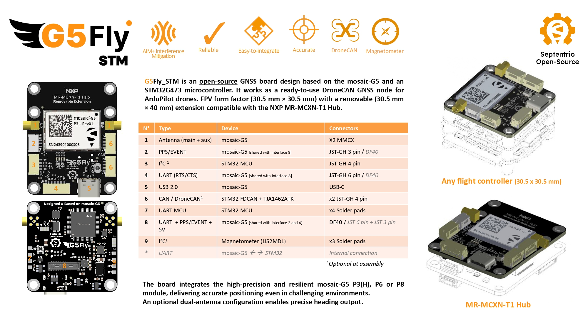
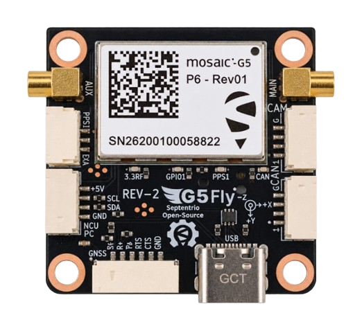
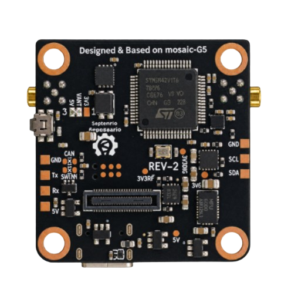
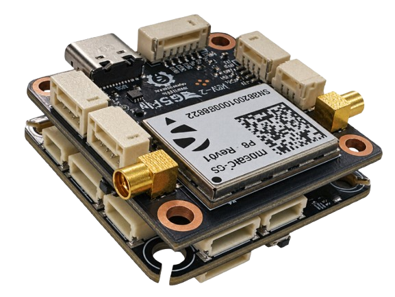
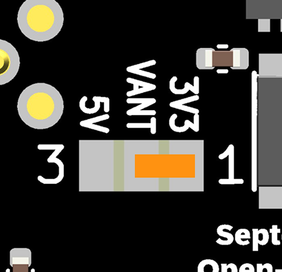
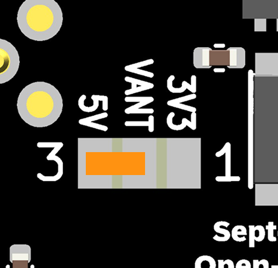
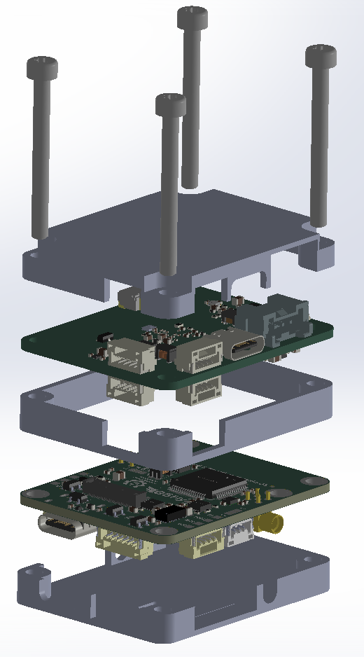
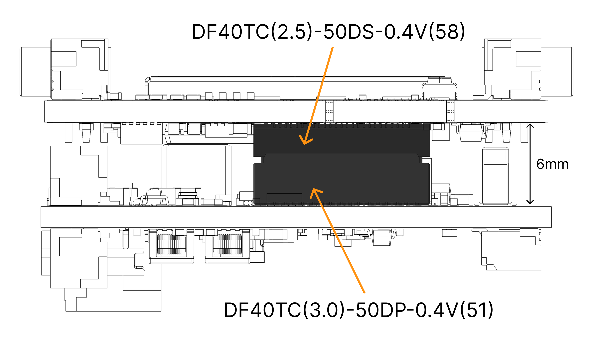

# G5Fly STM

**Open-source Septentrio GNSS board for FPV drones.**

[Features](#why-g5fly-stm-on-your-drone) •
[Getting started](#getting-started-on-an-fpv-drone) •
[Antenna](#antenna) •
[Production](#production-and-manufacturing) •
[Design guide](DESIGN.md) •
[License](#license)

G5Fly STM puts a Septentrio Mosaic-G5 GNSS receiver on a 30.5 x 30.5 mm FPV stack board. It mounts directly in your drone's stack and connects to your ArduPilot flight controller over DroneCAN or UART. An STM32G473 runs the AP_Periph firmware on board.

This repository contains the hardware design (KiCad), the production files and the AP_Periph firmware configuration.

Author: <a href="https://github.com/TheophileRaimbault">Théophile Raimbault</a> 
Contributors: <a href="https://github.com/amelaille">Amélie Hidalgo Peryllous</a>, <a href="https://github.com/robbe2000martens">Robbe Martens</a> 
Maintainer: Septentrio GNSS GitHub user <githubuser@septentrio.com> 
License: <a href="https://creativecommons.org/licenses/by-sa/4.0/">Creative Commons Attribution-ShareAlike 4.0</a> and <a href="https://www.oshwa.org/definition/">Open Source Hardware</a> 

  

<table>
  <tr>
    <td align="center"> <strong>Top</strong></td>
    <td align="center"> <strong>Bottom</strong></td>
  </tr>
</table>

   
  <em>G5Fly STM mounted in a 30.5 x 30.5 mm FPV stack</em>

<strong>Table of contents</strong>

- [Why G5Fly STM on your drone?](#why-g5fly-stm-on-your-drone)
- [Who is this repository for?](#who-is-this-repository-for)
- [Getting started on an FPV drone](#getting-started-on-an-fpv-drone)
  - [Interfaces](#interfaces)
- [Antenna](#antenna)
  - [Recommended antennas](#recommended-antennas)
- [Also compatible with the NXP MR-MCXN-T1 hub](#also-compatible-with-the-nxp-mr-mcxn-t1-hub)
- [Production and manufacturing](#production-and-manufacturing)
  - [JLCPCB requirements](#jlcpcb-requirements)
- [For designers and contributors](#for-designers-and-contributors)
- [Repository structure](#repository-structure)
- [License](#license)

## Why G5Fly STM on your drone?

- **Fits your FPV stack**: 30.5 x 30.5 mm mounting pattern, stacks directly with standard flight controllers and ESCs
- **Septentrio Mosaic-G5 accuracy**: multi-constellation, multi-frequency GNSS
- **Plug-and-play with ArduPilot**: AP_Periph node with DroneCAN support
- **Drone-standard connectors**: JST-GH connectors for DroneCAN, UART and I2C
- **Flexible antenna power**: 3.3 V or 5 V active antenna supply, selected with a jumper
- **Fully open source**: schematics, PCB, BOM and firmware configuration

## Who is this repository for?

- **Drone builders** who want to buy, assemble or fly the board as-is: start with the sections below.
- **Designers** who want to understand the hardware or make a custom version: go to [DESIGN.md](DESIGN.md).

## Getting started on an FPV drone

1. **Get a board**: build it from the production files in [hardware/versions/v1/kicad/production](hardware/versions/v1/kicad/production/) (see [Production and manufacturing](#production-and-manufacturing)).
2. **Set the antenna voltage**: solder `JP1` according to your antenna (see [Antenna](#antenna)).
3. **Flash the firmware**: build and flash AP_Periph using the configuration in [firmware](firmware/).
4. **Mount it in the stack**: install the board on the 30.5 x 30.5 mm pattern.
5. **Wire it to the flight controller**: use DroneCAN (recommended) or UART, then power it from the 5 V supply of the stack or via USB on the bench.
6. **Configure ArduPilot**: enable the DroneCAN GPS in Mission Planner (see [firmware/README.md](firmware/README.md)).
7. **Check before flying**: verify the status LEDs and wait for a valid GNSS fix outdoors.

### Interfaces

- **DroneCAN**: recommended link to the flight controller
- **UART**: direct serial link to the flight controller or a companion computer
- **I2C**: for external sensors
- **USB**: power and configuration on the bench
- **Reset input and status LEDs**

## Antenna

- Use an active antenna only with the voltage specified by the antenna manufacturer.
- Check the antenna connector and the `JP1` configuration before powering the board.
- On the drone, route the antenna cable away from the VTX, ESCs and motor wires, and mount the antenna with a clear view of the sky.

  <strong>Warning:</strong> Solder <code>JP1</code> before using an active antenna. If the jumper is left open, the <code>VANT</code> net is not powered and the antenna may not work, causing a significant loss of GNSS performance. Select only one voltage according to the antenna datasheet.

<table>
  <tr>
    <td align="center"> <strong>3.3 V antenna</strong> Connect <code>VANT</code> to <code>+3.3V_RF</code>.</td>
    <td align="center"> <strong>5 V antenna</strong> Connect <code>VANT</code> to <code>+5V</code>.</td>
  </tr>
</table>

### Recommended antennas

- D-Helix HX-CHX600A
- D-Helix HX-CH7609A
- Calian HC990EXF

An SMA-to-MMCX adapter is often needed to connect these antennas to the board.

## Also compatible with the NXP MR-MCXN-T1 hub

G5Fly STM is designed for FPV drones first, but it also works with the NXP MR-MCXN-T1 hub through its DF40 connector.

<table>
  <tr>
    <td align="center"> <strong>MR-MCXN-T1 housing</strong></td>
    <td align="center"> <strong>DF40 connector</strong></td>
  </tr>
</table>

See the [NXP integration guide (hardware and firmware)](resources/mr-mcxn-t1/NXP%20integration%20HW-FW.pdf) for details.

## Production and manufacturing

For a production build without hardware changes:

- Use the KiCad project and manufacturing files in [hardware/versions/v1/kicad](hardware/versions/v1/kicad/).
- Provide the manufacturer with the schematic, PCB files, BOM and CPL.
- Check the antenna connector type, jumper configuration and power options before assembly.

### JLCPCB requirements

- Keep the default KiCad PCB setup and its calculated impedance settings.
- Manufacture the board as a 6-layer PCB.
- `PCB Requirement: User.1 layer should be used as the V-cut guide layer.`
- Follow the PCB design rules in [hardware/common/design_rules/design-rules.md](hardware/common/design_rules/design-rules.md).
- Use the [G5Fly_STM_v1 production archive](hardware/versions/v1/kicad/production/G5Fly_STM_v1.zip), prepared for JLCPCB.

## For designers and contributors

The detailed hardware design guide is in [DESIGN.md](DESIGN.md). It covers:

- Overall architecture and major blocks
- Component selection and board organization
- How to create a custom derivative board
- Manufacturing and validation recommendations
- AP_Periph firmware configuration and DroneCAN bring-up

Useful resources:

- STM32 schematic: [resources/schematics/G5FLY_STM_schematics.pdf](resources/schematics/G5FLY_STM_schematics.pdf)
- Block diagram: [resources/schematics/G5Fly_STM32_drawio.png](resources/schematics/G5Fly_STM32_drawio.png)
- Contribution rules: [GUIDELINES.md](GUIDELINES.md) and [VERSIONING.md](VERSIONING.md)

## Repository structure

- [hardware](hardware): KiCad projects, libraries, 3D models, design rules and production files
- [firmware](firmware): AP_Periph configuration (`hwdef.dat`, `defaults.parm`)
- [resources](resources): photos, marketing visuals, schematics and MR-MCXN-T1 integration documents

## License

The G5Fly hardware design files (schematics, PCB layouts, production files) and documentation are released under the [Creative Commons Attribution-ShareAlike 4.0 International License](https://creativecommons.org/licenses/by-sa/4.0/) (CC BY-SA 4.0). See the [LICENSE](LICENSE) file for the full text.

You are free to share and adapt this design, including for commercial purposes, as long as you:
- **give appropriate credit** to Septentrio and the original authors,
- **indicate if changes were made**,
- **distribute your derivatives under the same license**.

G5Fly is open-source hardware and follows the [Open Source Hardware Definition](https://www.oshwa.org/definition/).

<a href="#g5fly-stm">Back to top ↑</a>
