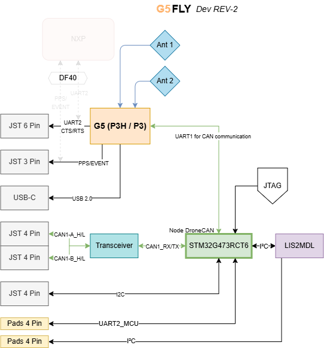

# G5Fly STM firmware (AP_Periph)

The G5Fly STM runs **ArduPilot AP_Periph**. It reads the Septentrio mosaic-G5 over UART (SBF protocol) and the on-board magnetometer, and publishes both on the CAN bus as a **DroneCAN GNSS + compass node** for flight controllers.

<p align="center">
  
</p>

| | |
|---|---|
| Board definition | [`SeptentrioG5Fly/`](SeptentrioG5Fly) (`hwdef.dat`, `defaults.parm`) |
| Flashed with | ST-LINK V2 using STM32CubeProgrammer |
| Tested with | ArduPilot and Cube Orange flight controller |
| License | Firmware files: GPL-3.0 (ArduPilot) |

## 1. Hardware mapping

All pins below are defined in [`hwdef.dat`](SeptentrioG5Fly/hwdef.dat) and match the G5Fly STM v1 schematic.

| Function | Peripheral | Pins | Notes |
|---|---|---|---|
| mosaic-G5 | USART1 (serial port 0) | PA10 RX, PA9 TX | SBF, 115200 baud |
| User / debug UART | USART2 (serial port 1) | PA3 RX, PA2 TX | Solder pads |
| DroneCAN | FDCAN1 | PA11 RX, PA12 TX | Through the TJA1462 transceiver, 1 Mbit/s |
| External I2C | I2C3 (bus 0) | PA8 SCL, PC9 SDA | JST-GH connector J7, 10 kΩ pull-ups |
| Magnetometer LIS2MDL | I2C4 (bus 1) | PC6 SCL, PC7 SDA | Address 0x1E, IIS2MDC driver |
| CAN status LED | GPIO | PB9 | See [LED behaviour](#led-behaviour) |
| Programming | SWD | PA13 SWDIO, PA14 SWCLK, NRST | Tag-Connect TC2030-NL (J5) |

### LED behaviour

| LED (PB9) | Meaning |
|---|---|
| Fast blink | Waiting for a DroneCAN node ID |
| Slow blink | DroneCAN running |

## 2. Build

```bash
# 1. Get ArduPilot
git clone --recursive https://github.com/ArduPilot/ardupilot.git
cd ardupilot

# 2. Install the build tools
Tools/environment_install/install-prereqs-ubuntu.sh -y
. ~/.profile
arm-none-eabi-gcc --version

# 3. Add the board definition
cp -r <path-to-this-repo>/firmware/SeptentrioG5Fly libraries/AP_HAL_ChibiOS/hwdef/

# 4. Build
./waf configure --board SeptentrioG5Fly
./waf AP_Periph
```

## 3. Flash the firmware (ST-LINK + STM32CubeProgrammer)

Tools: an ST-LINK and [STM32CubeProgrammer](https://www.st.com/en/development-tools/stm32cubeprog.html).
Connect the ST-LINK to the Tag-Connect footprint **J5** (TC2030-NL cable).

1. On Linux, allow USB access to the ST-LINK:
   ```bash
   sudo cp ~/STMicroelectronics/STM32Cube/STM32CubeProgrammer/Drivers/rules/*.rules /etc/udev/rules.d/
   sudo udevadm control --reload-rules
   sudo udevadm trigger
   ```
2. In STM32CubeProgrammer, select **ST-LINK** and set:

   | Field | Value |
   |---|---|
   | Port | SWD |
   | Frequency | 4000 kHz (1000 kHz if errors) |
   | Mode | Normal (use "Under reset" only if NRST is connected through your cable) |
   | Reset mode | Software reset |

3. **Connect**
4. **Erasing & Programming**:
   - run **Full chip erase**;
   - **Start Programming**. Expected: `Download verified successfully`.

## 4. Configure the mosaic-G5

On the mosaic-g5 port connected to the STM32 through the RxTools:

| Setting | Value |
|---|---|
| Baud rate | 115200 |
| Output | SBF |
| NMEA | Disabled on this port |
| SBF blocks | `PVTGeodetic`, `DOP`, `ReceiverStatus`, `VelCovGeodetic` |
| Rate | Start at 1–5 Hz, up to 10 Hz once validated |

## 5. Node parameters (AP_Periph)

These defaults are built into the firmware by [`defaults.parm`](SeptentrioG5Fly/defaults.parm):

| Parameter | Value | Meaning |
|---|---|---|
| `CAN_BAUDRATE` | 1000000 | 1 Mbit/s |
| `CAN_NODE` | 0 | Dynamic node ID allocation |
| `GPS_PORT` | 0 | USART1 (mosaic-G5) |
| `GPS1_TYPE` | 10 | Septentrio SBF |
| `GPS_AUTO_CONFIG` | 0 | Receiver configured manually |
| `GPS1_RATE_MS` | 100 | 10 Hz |
| `GPS_SAVE_CFG` | 0 | Do not write the receiver configuration |

---

## 6. Flight controller configuration (Cube with ArduPilot)

| Parameter | Value |
|---|---|
| `CAN_P2_DRIVER` | 1 |
| `CAN_D2_PROTOCOL` | 1 |
| `CAN_P2_BITRATE` | 1000000 |
| `GPS1_TYPE` | **9** |


## 9. PX4

The node publishes standard DroneCAN (UAVCAN v0) GNSS messages, so it should also work with PX4. This has not been tested yet. On PX4, DroneCAN must be enabled explicitly with `UAVCAN_ENABLE = 2` (sensors with dynamic node ID allocation).